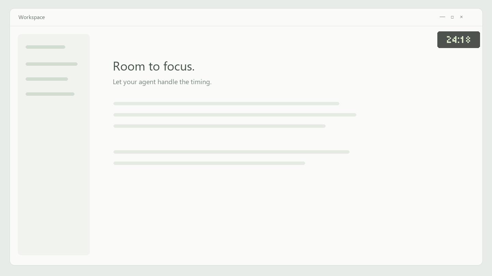

# timeprobe

**Your AI handles the stopwatch. You keep time in sight.**

A stopwatch for working with an AI agent on Windows. Ask it to start a session,
check the time, or record the result.
A small pixel display stays above your other windows. Hover and click to pause
or resume; drag it wherever it fits.

*Desktop concept preview. The widget shows only the time; pause appears on hover.*

## How it works

Ask your agent to start a session. The widget appears, and the agent handles the
rest of the controls. Your direct timing control is pause/resume.

Want a timer? Ask for a 30-minute target. The display counts down, plays one soft
chime at zero, then shows how far you've gone over. It keeps measuring until you
ask the agent to finish.

Pauses don't count toward the result. When you finish, the agent reads the actual
duration, records it, and closes the widget. Recent sessions stay in local history
for 24 hours.

## Install

Give your agent this repository and ask it to install both skills below.
The CLI skill walks it through installing the app on first use.
You'll need Windows, Python 3.10 or later, and Git.

## Why two skills?

| Skill | What it's for |
| --- | --- |
| [timeprobe-cli](skills/timeprobe-cli/SKILL.md) | How to operate the stopwatch: setup, commands, and responses. |
| [time-tracking](skills/time-tracking/SKILL.md) | How **you** want the agent to use it in your work: when to start, what to record, and when to finish. |

The CLI skill covers the controls; time-tracking defines your workflow.
You can and should edit time-tracking to fit how you work.

Try: “Start a 30-minute session.” Later: “I'm done. Record the time.”

Windows only. Desktop behavior tested on Windows 10 Pro 22H2, build 19045.6575, x64.

Forked from [chime-cli](https://github.com/MaVericKWareZ/chime) under the
[MIT license](LICENSE). The bundled Tiny5 font uses the
[SIL Open Font License](src/timeprobe/assets/ofl.txt).
